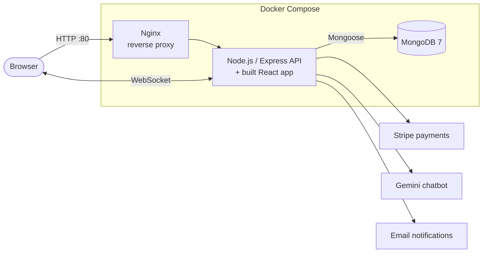

<h1 align="center">🌴 SerendibGo</h1>

<p align="center">
  A travel platform for Sri Lanka that brings hotels, tour packages, local guides and vehicle rentals into one place,
  with dashboards for travellers, service providers and admins.
</p>

<p align="center">
  
  
  
  
  
  
  
</p>

<p align="center">
  <a href="#-run-it">Run it</a> ·
  <a href="https://github.com/Blitz2001/SerendibGo">Original team repo</a>
</p>

<!-- TODO: add screenshots to docs/screenshots/, then uncomment:

-->

---

## ✨ Features

**Travellers:** book hotels, tours, local guides and vehicles · pay securely with Stripe · reviews and ratings · real-time messaging and notifications · AI travel chatbot (Gemini)

**Service providers:** separate portals for hotels, guides and vehicle owners to manage listings, bookings and earnings

**Admins:** user and role management, platform analytics, support requests, automated emails

---

## 🏗️ Architecture



- **Multi-stage Docker build:** stage 1 builds the React app, stage 2 ships only the server with production dependencies, running as a **non-root user** with a built-in **health check** (`/health`).
- **Docker Compose** runs three services: the app, MongoDB with a persistent volume, and Nginx in front as a reverse proxy.
- **API hardening:** JWT auth, `express-validator` input validation and `express-rate-limit`.
- **Tests:** Jest + Supertest for API and payment routes.

---

## 🧰 Tech stack

| Layer | Tools |
|---|---|
| Frontend | React 18, React Router, React Query, React Hook Form, Tailwind CSS, Socket.io client |
| Backend | Node.js, Express, Mongoose, JWT, Socket.io, Stripe, Gemini API |
| Database | MongoDB 7 |
| DevOps | Docker (multi-stage build), Docker Compose, Nginx |
| Testing | Jest, Supertest |

---

## 🚀 Run it

### With Docker (recommended)

```bash
git clone https://github.com/Gagana0819/SerendibGo.git
cd SerendibGo
cp .env.example .env.production    # fill in your own values
docker compose up --build app mongodb
```

App: http://localhost:5000 · Health check: http://localhost:5000/health

> The `nginx` service is the production setup: it redirects to HTTPS and expects a real domain in `nginx.conf` and certificates in `./ssl/`. Run `docker compose up --build` (all three services) only once those are in place.

### Without Docker

```bash
npm run install-all     # installs root, server and client dependencies
npm run dev             # API on :5000, React on :3000
```

### Environment variables

| Variable | Purpose |
|---|---|
| `MONGODB_URI` | MongoDB connection string |
| `JWT_SECRET`, `JWT_EXPIRE` | Auth tokens |
| `CLIENT_URL` | Frontend URL (for CORS) |
| `STRIPE_SECRET_KEY`, `STRIPE_PUBLISHABLE_KEY` | Payments (use test keys) |
| `GEMINI_API_KEY` | AI chatbot |
| `SMTP_HOST`, `SMTP_PORT`, `SMTP_USER`, `SMTP_PASS`, `EMAIL_FROM` | Email |

---

## 👨‍💻 My role

Team project (SLIIT, 3rd year).

<!-- TODO: add 3–4 bullets about what YOU built (modules, pages, APIs, Docker setup). Interviewers will ask. -->

> This is a fork of the team repository. The commit history here was squashed, so see the [original repo](https://github.com/Blitz2001/SerendibGo) for full history.

---

## 💡 What I learned & what I'd improve

**Learned**
- How a multi-stage Docker build keeps the production image small, and why the container should not run as root.
- Putting Nginx in front of the Node app as a reverse proxy.

**Next improvements**
- [ ] Add a GitHub Actions pipeline: install, run Jest tests, build the Docker image
- [ ] Remove default MongoDB credentials from `docker-compose.yml` and read them from `.env`
- [ ] Deploy a public demo
